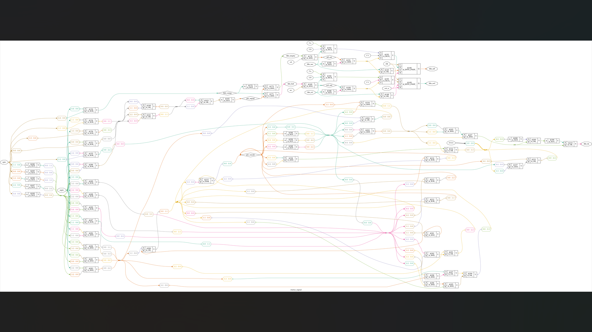

# 32-bit synchronous FIFO memory

Two single-clock FIFO implementations are included: the parameterized `fifo_memory` and the structural `fifo_memo`. The supplied configuration is 16 words by 32 bits with a threshold of eight words. Both modules are required by the testbench; OpenLane targets only `fifo_memory`.

The eight supplied test suites exercise basic writes/reads, full/empty flags, overflow/underflow, simultaneous activity, threshold flags, reset, and the parameterized implementation. They emit 22 pass messages. The simultaneous-activity suite reports completion without a full data scoreboard, and some stimulus occurs on rising clock edges. Passing this Icarus run is not exhaustive FIFO or simulator-independent verification. Although one implementation uses Gray-coded pointer signals, both use one clock; no asynchronous CDC capability is claimed.

## Synthesis images

[](docs/synthesis/)

[View all 3 synthesis screenshots and schematics](docs/synthesis/), including full-resolution gate diagrams.

## Run and inspect

From the repository root, with Python 3.10+ and Icarus Verilog installed:

```bash
python3 tools/run_checks.py --project fifo
```

The runner compiles only this project's sources, selects the intended testbench, rejects failure messages, checks the expected pass-message count, and saves a log and waveform under `sim_build/`. The new projects' checks use the supplied self-checking testbenches; they are directed tests, not an independent formal reference model.

For generic synthesis with Yosys, from this project directory:

```bash
yosys -s synth.ys
```

The generic synthesis script checks hierarchy and structure. It does not perform technology mapping, timing closure, or physical implementation. Current simulation and synthesis results are in [verification](../verification/).

## OpenLane and saved evidence

The root `config.json` and `config.tcl` reference the included `src/` files and target `fifo_memory` with a 20.0 ns clock. Use this project root as `DESIGN_DIR`; the old nested `designs/` layout is not required. These are OpenLane 1-style configs. With an appropriate OpenLane environment and SKY130 PDK installed, an example command from the OpenLane root is:

```bash
./flow.tcl -design /absolute/path/to/Projects/fifo-memory -tag new_run
```

The physical flow was **not rerun** for this upload. Exact historical tool/PDK revisions and resolved run configs were not supplied, so reproducing the saved layouts is not guaranteed.

Saved run `fifo32_run1` reports `flow completed`, zero Magic/KLayout DRC violations, and zero LVS errors. However, nominal extracted WNS is **0.0 ns**, the worst WNS in the three supplied extraction summaries is **0 ns**, and there are **5 antenna pin / 4 antenna net violations**. These snapshots do not establish signoff readiness.

- [Selected report evidence](evidence/openlane/)
- [Full saved reports and layout archive](https://github.com/Anikett20/Projects/releases/download/project-artifacts-2026-10-27/fifo-memory-physical-artifacts.zip)
- [Release and checksums](https://github.com/Anikett20/Projects/releases/tag/project-artifacts-2026-10-27)
- [Upload completeness audit](../verification/UPLOAD_AUDIT.md)
