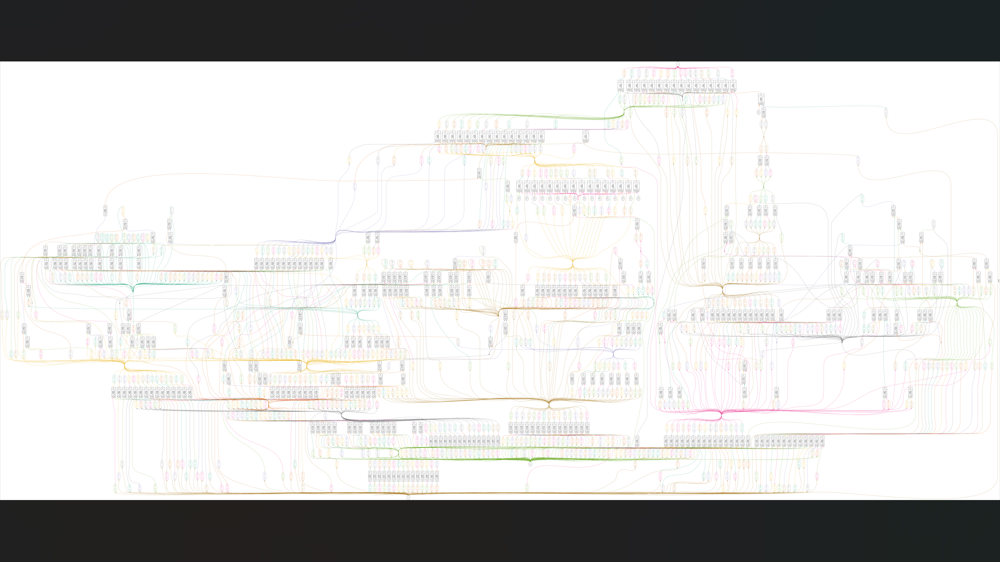

# Fixed-point matrix multiplication: synthesis images

Original screenshots and schematic exports added on 28 October 2026. Click the image to open it at its supplied resolution.

## Schematics and gate views

| Image | Resolution (pixels) | Size | Open or download |
| --- | ---: | ---: | --- |
| Synthesis schematic screenshot | 1,920 x 1,080 | 0.97 MiB | [View original PNG](fpmm-synthesis.png) |
| Top-level schematic | 11,605 x 9,924 | 12.43 MiB | [Full-resolution download](https://github.com/Anikett20/Projects/releases/download/synthesis-images-2026-10-28/fpmm_top_schematic.png) |
| Fixed-point adder gates | 15,870 x 6,971 | 13.86 MiB | [Full-resolution download](https://github.com/Anikett20/Projects/releases/download/synthesis-images-2026-10-28/fpmm_qadd_gates.png) |
| Fixed-point multiplier gates | 18,762 x 32,767 | 76.93 MiB | [Full-resolution download](https://github.com/Anikett20/Projects/releases/download/synthesis-images-2026-10-28/fpmm_qmult_gates.png) |

The largest PNGs are preserved as [release downloads](https://github.com/Anikett20/Projects/releases/tag/synthesis-images-2026-10-28) so cloning the source repository stays lightweight. All images retain their original bytes and resolution. [Checksums and source filenames](../../../verification/synthesis-images.json) record the complete set.

These are synthesis illustrations. Existing physical-design results and their limitations remain documented in the [project README](../../README.md).
