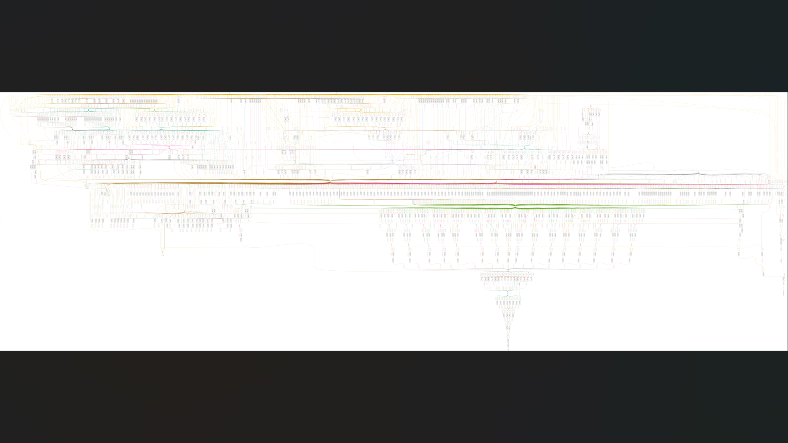

# 16-bit MIPS-style single-cycle processor

Educational single-cycle processor with a custom 16-bit instruction encoding, eight 16-bit registers, a 32-word hardware instruction ROM, and a 16-word data memory. It is not binary-compatible with standard MIPS.

The active program is encoded in `src/instruction_memory.v`. The `.hex` files are reference programs; the current RTL does not load them at runtime. Instruction fields are:

| Format | Fields |
| --- | --- |
| Register | opcode[15:12], rs[11:9], rt[8:6], rd[5:3], funct[2:0] |
| Immediate | opcode[15:12], rs[11:9], rt[8:6], immediate[5:0] |
| Jump | opcode[15:12], address[11:0] |

The supplied directed test checks seven final register values, one data-memory value, and the halt-loop PC. `tb/mips16_tb_detailed.v` is retained as an additional trace example; the portable runner selects `mips16_tb` explicitly.

## Synthesis images

[](docs/synthesis/)

[View all 4 synthesis screenshots and schematics](docs/synthesis/), including full-resolution gate diagrams.

## Run and inspect

From the repository root, with Python 3.10+ and Icarus Verilog installed:

```bash
python3 tools/run_checks.py --project mips16
```

The runner compiles only this project's sources, selects the intended testbench, rejects failure messages, checks the expected pass-message count, and saves a log and waveform under `sim_build/`. The new projects' checks use the supplied self-checking testbenches; they are directed tests, not an independent formal reference model.

For generic synthesis with Yosys, from this project directory:

```bash
yosys -s synth.ys
```

The generic synthesis script checks hierarchy and structure. It does not perform technology mapping, timing closure, or physical implementation. Current simulation and synthesis results are in [verification](../verification/).

## OpenLane and saved evidence

The root `config.json` and `config.tcl` reference the included `src/` files and target `mips16` with a 20.0 ns clock. Use this project root as `DESIGN_DIR`; the old nested `designs/` layout is not required. These are OpenLane 1-style configs. With an appropriate OpenLane environment and SKY130 PDK installed, an example command from the OpenLane root is:

```bash
./flow.tcl -design /absolute/path/to/Projects/mips16 -tag new_run
```

The physical flow was **not rerun** for this upload. Exact historical tool/PDK revisions and resolved run configs were not supplied, so reproducing the saved layouts is not guaranteed.

Saved run `mips16_run1` reports `flow completed`, zero Magic/KLayout DRC violations, and zero LVS errors. However, nominal extracted WNS is **-1.26 ns**, the worst WNS in the three supplied extraction summaries is **-1.56 ns**, and there are **16 antenna pin / 16 antenna net violations**. These snapshots do not establish signoff readiness.

- [Selected report evidence](evidence/openlane/)
- [Full saved reports and layout archive](https://github.com/Anikett20/Projects/releases/download/project-artifacts-2026-10-27/mips16-physical-artifacts.zip)
- [Release and checksums](https://github.com/Anikett20/Projects/releases/tag/project-artifacts-2026-10-27)
- [Upload completeness audit](../verification/UPLOAD_AUDIT.md)
