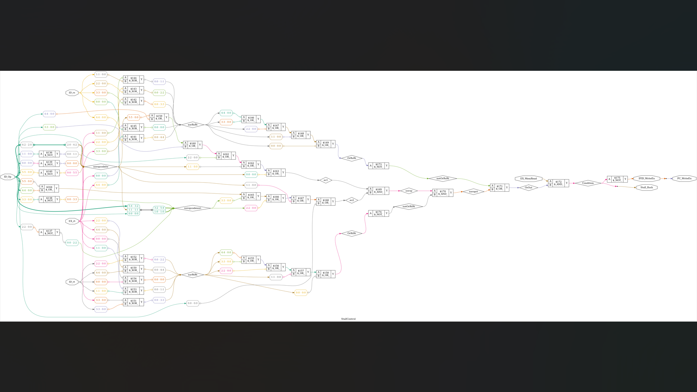

# 32-bit pipelined MIPS: synthesis images

Original screenshots and schematic exports added on 28 October 2026. Click the image to open it at its supplied resolution.

## Schematics and gate views

| Image | Resolution (pixels) | Size | Open or download |
| --- | ---: | ---: | --- |
| Stall-control synthesis screenshot | 1,920 x 1,080 | 0.32 MiB | [View original PNG](mips32-stall-screenshot.png) |
| Top-level schematic | 29,855 x 6,170 | 9.79 MiB | [Full-resolution download](https://github.com/Anikett20/Projects/releases/download/synthesis-images-2026-10-28/mips32_top_schematic.png) |
| Control-unit gates | 4,644 x 1,296 | 0.74 MiB | [View original PNG](mips32_ctrl_gates.png) |
| Forwarding-unit gates | 3,684 x 1,346 | 0.37 MiB | [View original PNG](mips32_forwarding_gates.png) |
| Stall-control gates | 5,596 x 2,015 | 0.80 MiB | [View original PNG](mips32_stall_gates.png) |

The largest PNGs are preserved as [release downloads](https://github.com/Anikett20/Projects/releases/tag/synthesis-images-2026-10-28) so cloning the source repository stays lightweight. All images retain their original bytes and resolution. [Checksums and source filenames](../../../verification/synthesis-images.json) record the complete set.

These are synthesis illustrations. Existing physical-design results and their limitations remain documented in the [project README](../../README.md).
